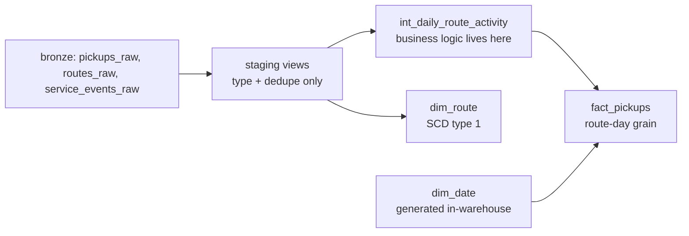

# Snowflake Warehouse Modeling (dbt)

**A production-style dbt project on Snowflake: staging → intermediate → marts,
modeled as a star schema so operations reporting has one tested source of truth
instead of scattered spreadsheet logic.**

> All seed data is **synthetic** (generated by `data/generate_seeds.py`).
> No employer or customer data is included.

## Architecture



## The Why

A warehouse without modeling conventions becomes a swamp: every analyst writes
their own join, the missed-pickup rate is defined three different ways, and
nobody trusts the numbers. This project applies the standard dbt layering —
staging (source-conformed), intermediate (business logic), marts (BI-facing
star schema) — so each concern has exactly one home and every KPI is defined
once, in SQL, with tests.

## Tech decisions & trade-offs

- **dbt on Snowflake:** dbt gives versioned, tested, documented SQL with a
  dependency graph; Snowflake's `TRY_TO_*` functions and zero-copy clones
  make the staging layer cheap and safe. The alternative (hand-run SQL
  scripts) has no lineage, no tests, and no documentation.
- **Star schema over fully normalized:** BI tools and analysts think in
  facts + dims. One wide `fact_pickups` at route-day grain keeps DAX simple
  and fast; normalized snowflakes push join complexity into every report.
- **Route-day grain:** operations questions are answered at route-day level.
  Per-pickup detail remains in staging for drill-through without bloating
  the fact table.
- **SCD type 1 for dim_route:** truck/driver reassignments are operational
  attributes where history isn't analytically required — overwrite is honest
  and simple. Documented upgrade path to type 2 if zone history becomes a
  reporting need.
- **KPI computed in the warehouse:** `missed_pickup_rate` is defined once in
  `fact_pickups`, not re-derived in each DAX measure, so the definition can't
  drift between dashboards.

## Tech stack

| Layer | Tool |
|---|---|
| Modeling | dbt Core |
| Warehouse | Snowflake |
| Seeds | CSV (synthetic, generated) |
| Tests / CI | dbt built-in tests, pytest (convention tests), GitHub Actions |

## Setup & run

Prerequisites: a Snowflake trial, dbt Core (`pip install dbt-snowflake`).

```bash
# 1. Generate synthetic seeds
python data/generate_seeds.py
# 2. Point dbt at your warehouse (never commit profiles.yml)
cp profiles.yml.example ~/.dbt/profiles.yml   # then fill in your trial creds
# 3. Build everything: seeds -> staging -> intermediate -> marts -> tests
dbt build
# 4. Explore lineage + docs
dbt docs generate && dbt docs serve
```

## Synthetic data strategy

`data/generate_seeds.py` reuses the repo-01 synthetic generator and copies its
output into `seeds/`, so reviewers run `dbt build` on a Snowflake trial with
zero ingestion setup. Same fixed seed (42), same domain, same guarantees:
no real data can enter this repo.

## Results

Screenshots to capture after `dbt build` (add to `docs/`):

1. `dbt docs` DAG screenshot — staging → intermediate → marts lineage
2. `dbt test` output showing all green (unique / not_null / relationships)
3. Sample `fact_pickups` rows in a Snowflake worksheet

## Limitations & roadmap

- dbt needs a live Snowflake to compile — CI runs structural convention
  tests (refs resolve, every model documented, every model has column tests)
  instead of a full `dbt build`.
- No incremental models yet: at this data volume, full refreshes are fine.
  Roadmap: incremental `fact_pickups` with `unique_key`, dbt snapshots for
  a type-2 `dim_route_history`, Great Expectations on marts.

## Tests & CI

- **dbt built-in tests** (`schema.yml`): `unique` + `not_null` on every
  natural key, `relationships` tests enforcing referential integrity
  (pickups → routes, facts → dims).
- **pytest convention tests** (`tests/test_modeling.py`): every `ref()`
  resolves to an existing model, every model is documented, every documented
  model declares column tests. Run in CI on every push.
